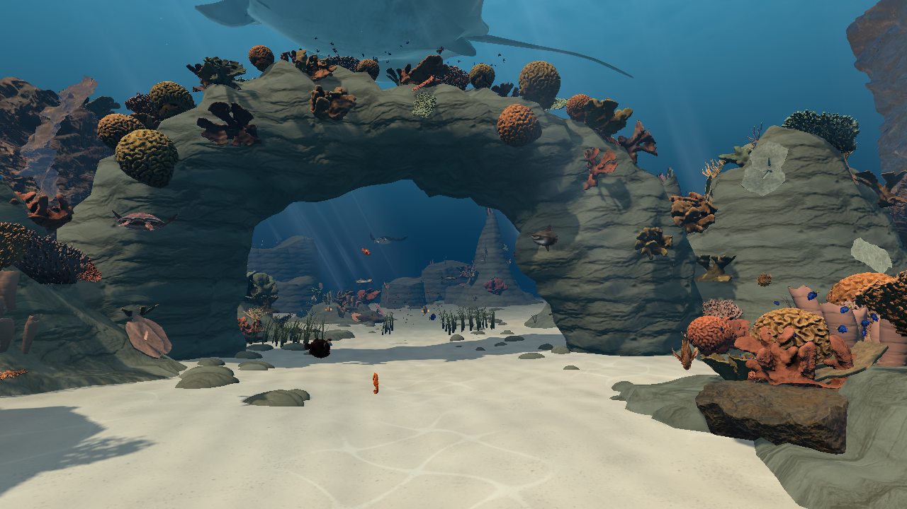
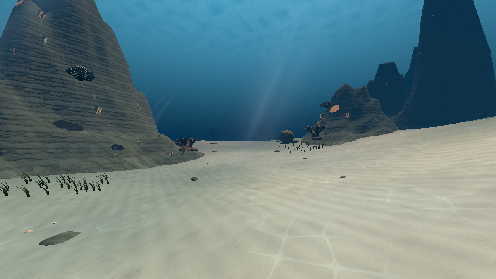
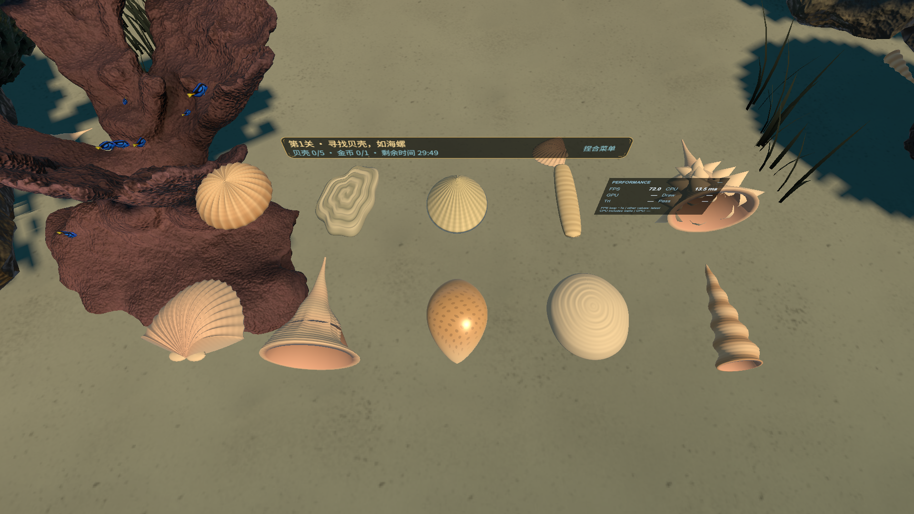

# 海底世界 · OceanWorld Unity

**用双手划过水流，穿行珊瑚之间，把海洋收藏进自己的图鉴。**

<p align="center"></p>

这是《海底世界》的 **PICO Unity 公开源码快照**，以 2.9.8 / code301 的前20关版本为基础。当前开放第1–20关，第21–100关保留历史身份及列表入口，点击提示“未开放，敬请期待”。原生 Spatial SDK 和 Apple Vision Pro 工程分别维护，不包含在本仓库中。

品牌插画不是游戏截图。下面的场景图来自现有工程的 Unity Editor 渲染，保留实际画面，不代表头显双眼画质或帧率。





## 可以怎么玩

- **自然手势潜游**：双手划水前进，单手辅助转向，抬头并向下推水可以上浮。
- **20关探索与挑战**：寻找不同贝壳和指定鱼类，尝试顺序收集，探索礁洞、草丛和隐藏金币。
- **海洋收藏**：十种贝壳、十种任务鱼，以及跨关卡的生物观察、说明、图鉴和成就。
- **手势渔枪**：拾取后，任一只手摆出手枪姿势即可显枪；弯曲食指射击。每个挑战关左右手共用20发，多条鲨鱼分别记录命中，受击后会逃离。
- **探索奖励**：完成本关主目标得两星，收齐本关金币后得三星。金币不能替代主目标。
- **联网排行榜**：积分榜与生物发现榜分别统计，支持中文昵称、服务端重名确认和连续翻页；断网先保存在本机，恢复联网后重试同步。有效收集按贝壳1分、鱼及捕获鲨鱼2分、金币10分计入积分。
- **海底氛围**：珊瑚礁拱、深浅沙谷、摆动海草、阳光焦散、气泡、鱼群与远处盘旋的巨鲲。



上图为了对照模型而集中排列贝壳；游玩时它们分散在沙地、珊瑚与草丛中。

| 操作 | 手势 |
| --- | --- |
| 前进 | 张开双手，向后推水，回手后再次划动 |
| 转向 | 自然转头，或单手划水辅助转向 |
| 上浮 | 抬头看向上方，用手向下推水 |
| 拾取 | 先张开手，靠近目标，再握拳 |
| 菜单 | 手势射线指向按钮，高亮后拇指与食指捏合 |
| 渔枪 | 先拾取；拇指上翘、食指伸直，其余三指握住，再弯曲食指单发射击 |

菜单打开时暂停移动和关卡计时。进度、星级、收藏、发现和成就保存在本机。

## 技术与开发工具

| 工具/依赖 | 实际用途 |
| --- | --- |
| Unity **6000.0.84f1** | 场景、C#玩法、动画、UI与Android构建 |
| URP **17.0.4** | 水下材质、光照、Shader与渲染 |
| PICO Unity XR SDK **6.1.1** | PICO头部/手部追踪、透视及XR运行时接入；须自行获取，不随源码分发 |
| XR Hands **1.7.3** / XR Interaction Toolkit **3.0.11** | Unity手部模型与交互基础；样例手模型须按说明本机导入 |
| Input System **1.19.0** / uGUI **2.0.0** | 输入与世界空间手势菜单 |
| OpenXR **1.16.1** / Meta OpenXR **2.4.1** | 保留的Quest构建支持；本次公开快照未做Quest真机验收 |
| **pico-cli** | 设备查询、安装、启动、截图和日志调试；它不是应用运行时SDK |
| **Codex** | 辅助C#开发、玩法/UI实现、资源处理、测试与代码审查 |
| Python / Git / Git LFS | 离线资源与数据检查、版本管理、大型美术文件存储 |

Android构建使用 **IL2CPP / ARM64 / OpenGLES3**。原生Spatial SDK与SpatialUI没有参与这个Unity版本的编译。

## 克隆与打开

先安装 Git LFS，再运行：

```sh
git lfs install
git clone https://github.com/alecchan2015/OceanWorld-Unity.git
cd OceanWorld-Unity
git lfs pull
```

1. 用Unity Hub安装 **6000.0.84f1**，包含Android Build Support、SDK、NDK与OpenJDK。
2. 按[依赖安装说明](docs/DEPENDENCIES.md)自行取得PICO SDK 6.1.1，并从XR Hands包恢复两只样例手模型。**本仓库不附带PICO专有SDK或Unity手模型FBX原件。**
3. 用Unity Hub打开仓库，等待包解析与资源导入。主场景为 `Assets/Scenes/UnderwaterWorld.unity`。
4. 按[联网排行榜配置](docs/LEADERBOARD.md)在发布环境私下配置HTTPS服务。未配置的Editor可检查本地玩法与缓存；正式Android构建会要求有效的联网配置。
5. Android目标保留PICO XR、ARM64、IL2CPP和OpenGLES3配置。Editor可以检查场景；真实手追、透视与舒适感须使用头显验收。

大型美术文件采用Git LFS。没有完成 `git lfs pull` 的指针文件不能作为模型或纹理导入。依赖尚未恢复时出现缺包或缺手模型提示，不代表完整工程已准备好。

## 构建

本机依赖、素材来源验证材料恢复并完成私有排行榜配置后，在仓库根目录执行（完整前提见[依赖说明](docs/DEPENDENCIES.md)）：

```sh
UNITY_EDITOR=/path/to/Unity ./Scripts/build-android.sh 2.9.8 301
```

入口为 `SwanUnderwater.Editor.CodexBuild.BuildAndroid`。输出放在被Git忽略的 `Builds/`。签名密钥由使用者自行配置；本仓库不包含开发者私钥、签名证书或可直接分发的APK。

## 公开版的差异与验证边界

- **联网功能保留**：公开源码包含HTTPS请求、设备端签名、服务端确认、积分与发现记录同步、离线队列和缓存。发布服务地址从本机未跟踪配置注入，服务器管理账号、私钥和生产地址不进入公开Git历史。没有配置时仅本地记录，不能当作已连上全服排行榜。详见[联网配置](docs/LEADERBOARD.md)。
- **内容分发范围**：保留已核实可再分发的素材及署名。移除未使用的旧备用环境资产；来源不明确的旧泡泡纹理改用已有、来源明确的CC0气泡图。
- **设备验收**：原PICO 2.9.8候选已有本地构建与保留存档安装记录；这不能替代本公开联网副本的独立重建或佩戴验收。本公开快照的实际检查状态见[验证说明](docs/VALIDATION.md)。
- **持续优化项**：真实手势容错、持续游动帧时、双目转场舒适感与跨平台一致性仍需实机复测，不承诺固定帧率。

## 目录

```text
Assets/SwanUnderwater/   玩法、手势、UI、程序化场景与Editor工具
Assets/Resources/       当前运行时加载入口
Assets/ArtSources/      已获许可的导入模型
Assets/ArtBaked/        材质、贴图、LOD等运行资源
Packages/               Unity依赖声明；不含私有SDK载荷
ProjectSettings/        项目与XR配置
Scripts/                构建、本地依赖恢复和公开内容检查
docs/                   玩法、依赖、素材说明及实际截图
```

## 许可

这是公开可查看的源码快照，**尚未为项目原创代码选择统一开源许可证**。公开仓库不等于将所有代码、美术或SDK统一授权为MIT或CC0。

第三方素材分别适用CC0、CC BY 4.0、OFL、MIT等条款；作者、来源和修改说明见[第三方许可](THIRD_PARTY_LICENSES.md)及[美术资源说明](docs/ASSETS.md)。PICO SDK与Unity包/样例受各自条款约束，使用者须自行取得适用授权。作者或机构的署名不代表对本项目的认可。
