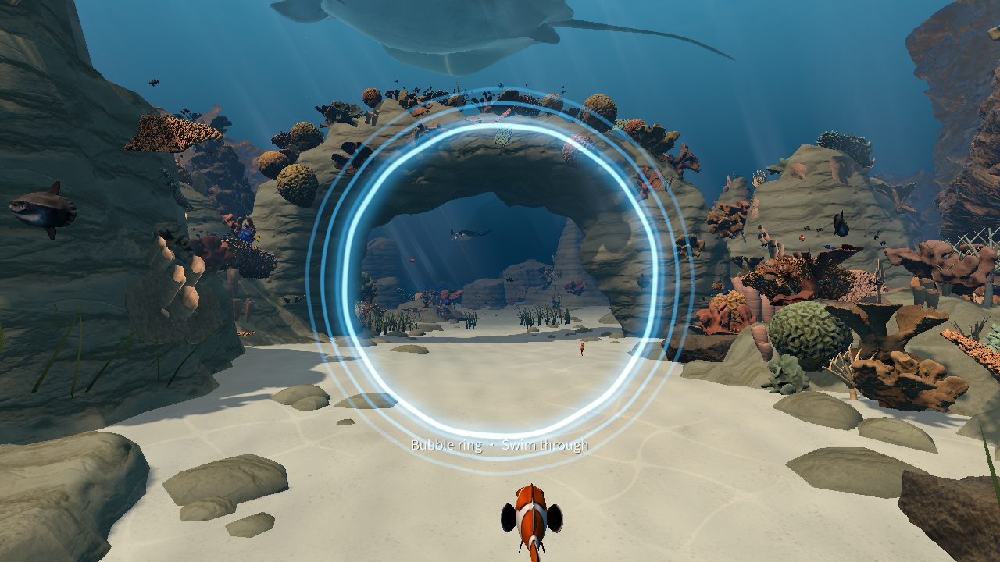

# 海底世界 · OceanWorld

**Swim with your hands. Discover a living ocean.**

伸手划过水流，穿过珊瑚礁拱。追随游鱼，寻找贝壳，把每一次发现放进自己的海洋图鉴。

OceanWorld 是一款为 PICO 打造的 Unity 水下探索游戏。它从一个简单的好奇开始：身处海底，会是什么感觉？现在，用双手游泳、靠近观察，在一段段小冒险中认识这片海。

**当前 PICO 体验版：[2.9.24 / code317](docs/RELEASE_2.9.24.md)** · 前20关开放 · 中英双语 · 手势探索

[构建2.9.24](#构建-android-apk) · [版本说明](docs/RELEASE_2.9.24.md) · [观看水波圈预览](docs/videos/ripple-gate-2.9.24.mp4) · [操作指南](#第一次游玩)



*图与视频来自受控 Unity Editor 预览：固定场景和相机，只推进水波特效时钟，其他生物静止。它们展示特效外观，不是头显录屏或设备 FPS。*

## 潜入这片海

- **用双手游泳。** 张手向后划水，自然转头或用单手辅助转向；靠近物品后握拳抓取。
- **有目标，也能慢慢看。** 收集十种贝壳、指定目标鱼和隐藏金币；观察海龟、海豚等海洋居民，留意沙地、草丛与礁洞里的线索。
- **看得见的图鉴。** 当前30类生物条目显示对应真实参考模型，尚未发现的条目也能预览外形。探索线索、发现状态与介绍解锁分别保留，预览模型不会替玩家增加发现记录。
- **生物与环境更贴合。** 鲭鱼有更立体的躯干；鲭鱼、海龟和海豚的原生游动节奏随实际移动平滑变化。蝶鱼近景会响应礁体主光阴影。
- **短暂的发光水波。** 第6关的穿环引导靠近时显现，亮青色核心外有柔和光晕与向外扩散的波纹；穿过后扩散消失，完成、暂停或闲置后不再固定留在海底。
- **顺手的菜单。** 捏合点击有反馈，教学支持快捷关闭；主菜单或设置中可开关性能面板。系统语言提供初始中文/英文默认值，也可手动切换并记住选择。

本地保存续关、收藏、最佳星级与成就。当前版本关闭排行榜、昵称输入及服务器同步。只有第1–20关可进入；第21–100关保留列表入口与旧历史，点击显示未开放。

## 不同关卡，不同探索方式

主线包含贝壳寻宝、鱼类辨认、顺序收集与鲨鱼挑战。部分关卡还提供可选活动，让同一片海有新的探索节奏：

| 关卡 | 可选活动 |
| --- | --- |
| 6 · 珊瑚秘境 | 沿沙谷划水，依次穿过三个短暂显现的水波引导圈 |
| 9 · 暮色识鱼 | 张手稳定观察蓝倒吊与小丑鱼，再捏合记录 |
| 14 · 古礁密码 | 记住三次发光顺序，再依次捏合礁石符文 |
| 16 · 洋流竞逐 | 在导流叶附近张手指向并划动，引导三段洋流 |
| 18 · 深海大巡游 | 张手引导海龟，分两段护送到安全圈 |

这些活动不替代主目标，也不改变原星级判定。完成主目标获得 **★★**，再收齐本关全部金币获得 **★★★**。

## 第一次游玩

| 想做什么 | 怎么操作 |
| --- | --- |
| 向前游 | 张开双手，向后推水；回手后再划下一次 |
| 调整方向 | 自然转头，或用单手划水辅助转向 |
| 向上探索 | 抬头看向上方，用手向下推水 |
| 抓取 | 手掌靠近目标，先张开再握拳 |
| 点击菜单 | 手势射线指向按钮，高亮后捏合；松开后再选择 |
| 查看目标 | 打开「本关目标」，对照模型与收集状态 |
| 关闭教学 | 点击教学面板上的快捷关闭按钮 |
| 切换语言 / 性能面板 | 在主菜单或设置中调整 |

鲨鱼挑战中先拾取渔枪，再按教学手势弯曲食指单发射击。每个挑战关共用20发弹药；命中次数按单条鲨鱼独立累计，以本关目标提示为准。目标鱼的收集与其他居民的观察图鉴是不同的进度。

## 下载与保留存档升级

下表记录本次已完成构建并安装到 PICO 的2.9.24包身份。体验包可按下文从源码构建；自行重建会产生新的构建标识和校验值。当前仓库提供源码与预览素材，没有已发布的Release下载资产。

| 项目 | 本次构建 |
| --- | --- |
| 文件 | `OceanWorld-PICO-v2.9.24-code317.apk` |
| Android 包名 | `com.picoxr.swan.underwater` |
| 版本 | `2.9.24-codex.20261029T062847197Z-ffaf10c9` / code317 |
| 大小 | 529,451,130 字节 |
| 后端 / 架构 | IL2CPP / ARM64，OpenGLES3，非Development |

SHA256：

```text
c5e253d84274d0d6bb1fb7e56c49e5d785bf9a23d1645c4e3721b6fd70275a00
```

在启用开发者连接的 PICO 上，用实际设备序列号替换 `DEVICE_SERIAL`：

```sh
adb devices
adb -s DEVICE_SERIAL pull /sdcard/Android/data/com.picoxr.swan.underwater/files ./OceanWorld-save-backup
adb -s DEVICE_SERIAL install -r OceanWorld-PICO-v2.9.24-code317.apk
```

`install -r` 用于同签名覆盖升级。保留原应用，不卸载、不清数据。签名密钥不随源码分发；自行构建的 APK 若签名不同，不能直接覆盖旧体验包。安装后在头显打开「海底世界」。

本次已在 PICO B3110 上从313覆盖安装317，并核对首次启动前15份可读取应用文件逐字节保持，包含关卡、成就、图鉴及备份。内部私有偏好受系统权限保护，未做字节读取；这次记录不等于所有设备的升级或佩戴体验验收。

## 打开源码工程

1. 安装 Git LFS，克隆本仓库并拉取大文件。
2. 在 Unity Hub 安装 **Unity 6000.0.84f1**，包含 Android Build Support、Android SDK & NDK Tools、OpenJDK。
3. 按[公开源码依赖恢复说明](https://github.com/JacksonGreatWorld/OceanWorld-Unity/blob/main/docs/DEPENDENCIES.md)安装本工程所需的官方平台依赖，再将项目加入 Unity Hub，等待导入。
4. 打开 `Assets/Scenes/UnderwaterWorld.unity`，选择 Android；保留工程的 PICO XR、ARM64、IL2CPP 与 OpenGLES3 配置。

```sh
git lfs install
git clone https://github.com/JacksonGreatWorld/OceanWorld-Unity.git OceanWorld-Unity
cd OceanWorld-Unity
git lfs pull
```

公开源码按第三方许可和分发清单整理，部分供应商依赖需从官方渠道自行恢复。不要将 SDK、模型、字体或整个工程视为统一的开源许可；游戏源码没有因此自动授予开源授权。

## 构建 Android APK

在仓库根目录，将 `UNITY_EDITOR` 设为本机 Unity 可执行文件：

```sh
UNITY_EDITOR=/path/to/Unity ./Scripts/build-android.sh 2.9.24 317
```

脚本调用 `SwanUnderwater.Editor.CodexBuild.BuildAndroid`，在构建前执行项目回归检查。输出 APK、构建清单与校验值位于 `Builds/codex-v34/` 的本次构建子目录。后续升级应递增 versionCode；构建前保存场景，并退出该项目的其他 Unity 实例。

原始 PICO317 输入已完成完整 Editor 回归、真实 IL2CPP/Gradle 构建、签名与包体核验，0错误/18警告。水波生命周期518项、真实礁石与5类可选活动714项检查分别通过，不合并为一个性能指标。公开源码变体的依赖、配置差异与验证范围见[发布映射说明](https://github.com/JacksonGreatWorld/OceanWorld-Unity/blob/main/docs/VALIDATION.md)。

当前包已安装并打开，真实双目观感、手势及持续设备性能仍需佩戴验证；不宣称已通过商店审核、供应商库16KiB LOAD兼容或达到某个设备FPS。

## 资源、平台与更多资料

- [2.9.24变更与验证](docs/RELEASE_2.9.24.md)
- [操作与玩法](#第一次游玩) · [美术素材](https://github.com/JacksonGreatWorld/OceanWorld-Unity/blob/main/docs/ASSETS.md)
- [第三方资源与许可](THIRD_PARTY_LICENSES.md)
- [珊瑚与礁石来源](ASSET_SOURCES_REALISTIC.md)
- 其他平台采用各自的工程和交付记录，本轮仅更新 PICO Unity。

当前介绍和验证范围以 PICO Unity2.9.24为准。Quest、Apple Vision Pro 与 Spatial 版本保留各自的工程和交付记录，本轮没有重建，不能把 PICO 的验证结果直接外推到其他平台。珊瑚配色、鱼体和场景经过游戏化处理，游戏不是海洋生态的科学复原。
