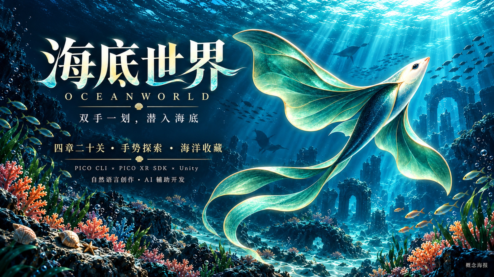
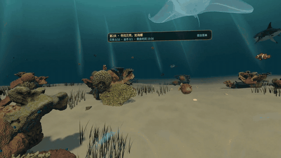
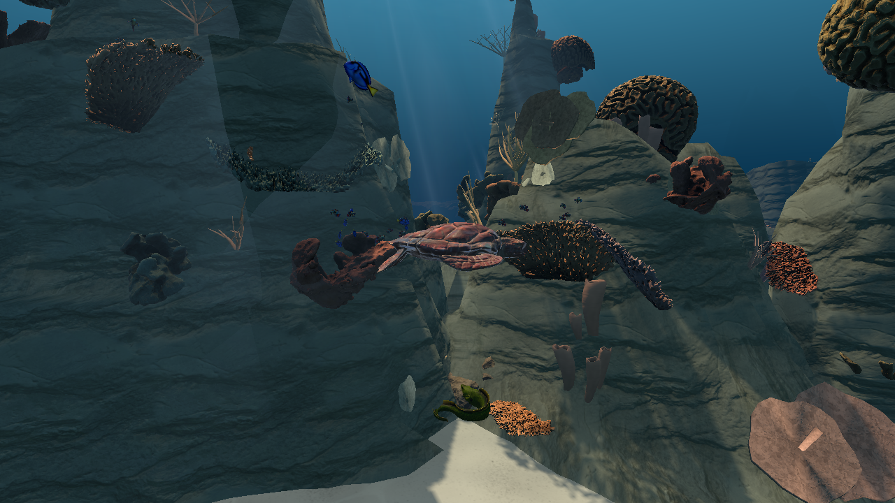

# 海底世界 · OceanWorld Unity

**用双手划过水流，穿行珊瑚之间，把海洋收藏进自己的图鉴。**



*基于用户提供的海报，经AI辅助排版扩展的品牌概念图；实际游戏画面见下方。*

**四章二十关 · 自然手势潜游 · 海洋收藏 · 隐藏金币 · 鲨鱼挑战**

这是《海底世界》的 **PICO Unity 公开源码快照**，当前同步至 **[2.9.20 / code313](docs/RELEASE_2.9.20.md)** 的玩法与界面输入：五种可选探索支线、更柔和的生物运动、点击反馈、教学快捷关闭，以及简体中文 / English 即时切换。当前开放第1–20关，第21–100关保留历史身份及列表入口，点击提示“未开放，敬请期待”。原生 Spatial SDK 和 Apple Vision Pro 工程分别维护，不包含在本仓库中。

从眼前悠闲的小丑鱼开始，跟随它穿过入场通道，再亲手划入海底。沿着沙道穿过礁拱，在草丛和珊瑚背面寻找贝壳；也可以停下来，观察游鱼的轮廓，抬头看看远处盘旋的巨鲲。

这里的探索有快慢两种节奏：按目标寻找、辨认和抓取，是每一关的挑战；沿途记录生物、补齐收藏、寻找隐藏金币，则让同一条路线值得再游一次。

[四章二十关](#chapters) · [收藏与生物观察](#collection) · [本地进度与成就](#local-progress) · [一分钟上手](#controls) · [技术与开发工具](#development-tools)

品牌插画不是游戏截图。下面的场景图来自现有工程的 Unity Editor 渲染，保留实际画面，不代表头显双眼画质或帧率。


### 看一段真实潜游

[](https://github.com/JacksonGreatWorld/OceanWorld-Unity/raw/refs/heads/main/docs/videos/oceanworld-gameplay-720p.mp4)

**[↓ 下载完整游戏录屏](https://github.com/JacksonGreatWorld/OceanWorld-Unity/raw/refs/heads/main/docs/videos/oceanworld-gameplay-720p.mp4)** · 20秒 · 720p · 静音 · 约3.7MB · [视频文件页](https://github.com/JacksonGreatWorld/OceanWorld-Unity/blob/main/docs/videos/oceanworld-gameplay-720p.mp4)

此段为2026-10-11留存的早期Unity游戏录屏，展示划水水纹、虚拟手与生物巡游。设备和精确构建版本未记录，不作为当前2.9.20或后续版本的佩戴验收。动图取自同一视频；已去除音轨与元数据。

## 可以怎么玩

- **自然手势潜游**：双手划水前进，单手辅助转向，抬头并向下推水可以上浮。
- **20关探索与挑战**：寻找不同贝壳和指定鱼类，尝试顺序收集，探索礁洞、草丛和隐藏金币。
- **五段可选小冒险**：穿过气泡环、安静观察游鱼、记住符文、划动导流，再引导海龟回到安全圈。可选支线不改变原主目标与星级条件。
- **海洋收藏**：十种贝壳、十种任务鱼，以及跨关卡的生物观察、说明、图鉴和成就。
- **手势渔枪**：拾取后，任一只手摆出手枪姿势即可显枪；弯曲食指射击。每个挑战关左右手共用20发，多条鲨鱼分别记录命中，受击后会逃离。
- **探索奖励**：完成本关主目标得两星，收齐本关金币后得三星。金币不能替代主目标。
- **本地记录与成就**：收藏、观察、星级和累计收获保存在本机，重玩可继续完善图鉴与成就。**本版关闭排行榜、昵称输入和自动联网同步**，已有本地历史保留。
- **海底氛围**：珊瑚礁拱、深浅沙谷、分层山脊、随流海草、漂流微粒与远处盘旋的巨鲲；近鱼逐渐减速和恢复巡游，海龟等观察居民会短暂让行。
- **清楚的操作反馈**：菜单点击后有短促扩散环；教学提供可见的关闭按钮。性能面板可从主菜单或设置打开。


上图为了对照模型而集中排列贝壳；游玩时它们分散在沙地、珊瑚与草丛中。

<details>
<summary>更多画面：海龟、早期礁谷与应用插画</summary>




<p align="center"></p>

*以上保留历史Editor画面与品牌插画，供了解模型与美术演进；不作为当前头显效果与性能验收。*

</details>

<a id="chapters"></a>

## 四章二十关，从拾贝到深海之冠

第1–5关在最初的礁区熟悉动作，第6关起进入 **珊瑚秘境**：礁拱、沙谷、海草与礁壁构成新的搜索路线。四章是任务进程，并非四张独立地图。开放关卡可以从菜单直接选择，也适合按顺序逐步熟悉游泳、辨认和寻宝。

| 篇章 | 你将遇到的挑战 | 金币与章末目标 |
| --- | --- | --- |
| **第一章 · 初识海洋**<br>第1–5关 | 从五种贝壳开始，进而收齐十种；尝试贝壳与鱼类混合收集，在第4关辨认四种指定鱼。 | 每关1枚金币。第5关不限时：找到渔枪，对任意一条鲨鱼单独累计命中10次，再靠近抓取。 |
| **第二章 · 珊瑚迷踪**<br>第6–10关 | 在珊瑚秘境寻找河豚、海马与贴底的比目鱼；第8关按顺序收鱼。限时从18分钟收紧到15分钟。 | 每关2枚金币。第10关需要贝壳、鱼类收集，以及累计命中11次后的鲨鱼抓取。 |
| **第三章 · 深蓝追猎**<br>第11–15关 | 搜索范围扩大，开始兼顾鱼类辨认与沙地寻踪；第12关按顺序收鱼，第14关按顺序拾贝。限时14–12分钟。 | 每关3枚金币。第15关包含四种鱼、四种贝壳，以及累计命中12次后的鲨鱼抓取。 |
| **第四章 · 深海之冠**<br>第16–20关 | 在11–10分钟内安排搜索路线；第18关集齐十种鱼，第19关收齐十鱼十贝并遵守鱼类顺序。 | 第16–19关各4枚金币，第20关5枚。第20关需要十鱼十贝，以及累计命中14次后的鲨鱼抓取。 |

### 沿途还有五段小冒险

| 关卡 | 可选支线 | 体验重点 |
| --- | --- | --- |
| 6 | 三段气泡环 | 沿着沙谷，按顺序真正游过环面。 |
| 9 | 安静观察 | 张开手，稳定视线和射线，再捏合记录两类游鱼。 |
| 14 | 三符文记忆 | 先看亮起顺序，再用分开的捏合复现。 |
| 16 | 洋流导流 | 靠近导流叶，张手指向并划动；静止指向不算完成。 |
| 18 | 海龟护航 | 张开手，把海龟引向安全圈。 |

这些是沿原路线布置的可选探索。完成支线不替代收贝、捕鱼、寻金或鲨鱼主目标，也不会补发旧星级。

**先完成目标，再寻找满星。** 本关全部主目标完成得 **★★**，再收齐本关全部隐藏金币得 **★★★**；只找到金币不会直接通关。主目标完成后，可在剩余时间内继续探索。第20关完成后可重玩、继续探索或退出，不会进入未开放的第21关。

鲨鱼挑战各有 **20发弹药**，左右手共用，多条鲨鱼的命中数分别记录。达到要求后还要靠近抓取；最后一发让某条鲨鱼达到要求时，仍保留抓取机会。放松射击姿势即可隐藏渔枪，再用双手划水接近下一个观察点。

<a id="collection"></a>

## 把一次潜游，变成自己的海洋收藏

**十种贝壳，十种任务鱼。** 从扇贝的放射纹、海螺的螺旋，到蛏子的细长壳体与骨螺的棘饰，每种外形都有自己的识别点。目标页告诉你这一轮还缺什么，收藏库记录已经取得的不同类别。海里还有营造氛围的游鱼，并非每条看得到的鱼都是本关抓取目标。

**不抓取，也能记录发现。** 张开手，用手势射线稳定指向6米内的可观察生物约 **2秒**，等待观察金环完成，便可记录名称，解锁简短说明、栖息线索和模型预览。图鉴当前提供 **30类可观察记录**，涵盖鱼类、海龟、海豚、珊瑚与贝壳外形；它不是30种鱼，也不把模型类别当作精确物种鉴定。部分记录随关卡逐步出现，稀有类别需要留意礁隙、草丛或开阔水道。

**重玩有自己的收获。** 收藏、观察记录和历史最佳星级跨关保留。第一次拾贝、收齐十种贝壳、观察新生物、找到隐藏金币、获得三星或捕获鲨鱼，都有对应的本地成就进度。你可以重玩熟悉的关卡挑战三星，也可以按照图鉴线索找齐漏掉的记录；重新开始本关会重置这一轮目标，不清除已有收藏与历史荣誉。未开放内容所需的后续成就保留规划和旧记录，不代表当前20关已经能完成所有成就。

隐藏金币用金光与金币喷涌庆祝这次发现。越往后的关卡，金币越多；完成主要目标后，再看看刚才绕过的礁石背面，也许还有一份收藏等待带走。

<a id="local-progress"></a>

## 留在本机的海洋旅程

| 记录 | 你可以继续完成的目标 |
| --- | --- |
| **关卡与星级** | 重玩开放的20关，完成主目标，再找齐隐藏金币冲击三星。 |
| **收藏与观察图鉴** | 跨关保留已发现类别，沿着栖息线索寻找漏掉的生物与贝壳。 |
| **本地成就** | 累计拾贝、捕鱼、寻金和完成关卡；重复处理同一枚拾取物不会重复累计。 |

本版完全关闭积分榜、生物发现榜、昵称输入及自动网络同步。旧版本的本地历史与未上传事件继续保留，不展示旧昵称，也不会因旧上传队列已满而卡住新的本地收集。它不是跨设备云存档；保留本机应用数据，才能继续这段旅程。

<a id="controls"></a>

## 一分钟上手

新档首次进入第1关有四步教学：**张手保持 → 划水并停下 → 握抓练习扇贝 → 打开菜单查看目标**。让双手处在头显能够看到的位置，自然推水即可，不必急着连续用力。教学图示下方和教学期间的菜单右上角都有 **“关闭教学 / Close tutorial”**；关闭本次教学后可以继续探索，不会伪造练习、收藏或成就。菜单的舒适设置提供速度、人工转向与音量调整，也可以重看教学。

| 操作 | 手势 |
| --- | --- |
| 前进 | 张开双手，向后推水，回手后再次划动 |
| 转向 | 自然转头，或单手划水辅助转向 |
| 上浮 | 抬头看向上方，用手向下推水 |
| 拾取 | 先张开手，靠近目标，再握拳 |
| 生物观察 | 张开手，用手势射线稳定指向6米内的可观察生物约2秒 |
| 菜单 | 手势射线指向按钮，高亮后拇指与食指捏合 |
| 渔枪 | 先拾取；拇指上翘、食指伸直，其余三指握住，再弯曲食指单发射击 |
| 切换语言 | 设置 / 教学 → 语言 / Language → 跟随系统、简体中文或 English |
| 性能面板 | 主菜单或设置中打开；显示 FPS、CPU、GPU、绘制 / Draw、三角 / Tri、切换 / Pass |

默认跟随系统语言：中文系统显示简体中文，英文系统显示英文；其他系统语言按 Locale 地区回退，中国显示中文，美国及其他地区显示英文。手动选择优先，立即刷新并在本机记住。地区来自操作系统，不使用 IP 定位。

一次握抓只处理一个目标，下一次先松手再握；不能隔着礁石抓取。食指持续弯曲不会连发，需先伸直再扣动。菜单打开时暂停移动和关卡计时，收起后继续探索。进度、星级、收藏、发现和成就保存在本机。

<a id="development-tools"></a>

## 技术与开发工具

| 工具/依赖 | 实际用途 |
| --- | --- |
| Unity **6000.0.84f1** | 场景、C#玩法、动画、UI与Android构建 |
| URP **17.0.4** | 水下材质、光照、Shader与渲染 |
| PICO Unity XR SDK **6.1.1** | PICO头部/手部追踪、透视及XR运行时接入；须自行获取，不随源码分发 |
| XR Hands **1.7.3** / XR Interaction Toolkit **3.0.11** | Unity手部模型与交互基础；样例手模型须按说明本机导入 |
| Input System **1.19.0** / uGUI **2.0.0** | 输入与世界空间手势菜单 |
| OpenXR **1.16.1** / Meta OpenXR **2.4.1** | 保留的Quest构建支持；本次公开快照未做Quest真机验收 |
| **pico-cli** | 设备查询、安装、启动、截图和日志调试；它不是应用运行时SDK |
| **Codex** | 辅助C#开发、玩法/UI实现、资源处理、测试与代码审查 |
| Python / Git / Git LFS | 离线资源与数据检查、版本管理、大型美术文件存储 |

Android构建使用 **IL2CPP / ARM64 / OpenGLES3**。原生Spatial SDK与SpatialUI没有参与这个Unity版本的编译。

## 克隆与打开

先安装 Git LFS，再运行：

```sh
git lfs install
git clone https://github.com/JacksonGreatWorld/OceanWorld-Unity.git
cd OceanWorld-Unity
git lfs pull
```

1. 用Unity Hub安装 **6000.0.84f1**，包含Android Build Support、SDK、NDK与OpenJDK。
2. 按[依赖安装说明](docs/DEPENDENCIES.md)自行取得PICO SDK 6.1.1，并从XR Hands包恢复两只样例手模型。**本仓库不附带PICO专有SDK或Unity手模型FBX原件。**
3. 用Unity Hub打开仓库，等待包解析与资源导入。主场景为 `Assets/Scenes/UnderwaterWorld.unity`。
4. 本版无需排行榜服务地址。不要恢复 `PrivateRelease` 配置；Android构建检查会拒绝携带该目录的关闭版。历史架构与本版数据处理见[排行榜关闭说明](docs/LEADERBOARD.md)。
5. Android目标保留PICO XR、ARM64、IL2CPP和OpenGLES3配置。Editor可以检查场景；真实手追、透视与舒适感须使用头显验收。

大型美术文件采用Git LFS。没有完成 `git lfs pull` 的指针文件不能作为模型或纹理导入。依赖尚未恢复时出现缺包或缺手模型提示，不代表完整工程已准备好。

## 构建

本机依赖、素材来源验证材料恢复，并确认没有私有排行榜配置后，在仓库根目录执行（完整前提见[依赖说明](docs/DEPENDENCIES.md)）：

```sh
UNITY_EDITOR=/path/to/Unity ./Scripts/build-android.sh 2.9.20 313
```

入口为 `SwanUnderwater.Editor.CodexBuild.BuildAndroid`。输出放在被Git忽略的 `Builds/`。签名密钥由使用者自行配置；本仓库不包含开发者私钥、签名证书或可直接分发的APK。

## 公开版的差异与验证边界

- **排行榜关闭**：本版没有排行榜入口或昵称编辑，不创建签名身份、不发起排行请求，也不自动上传积分和发现。旧账本、去重身份和未上传事件保留；新收集继续累加本地成就所需事实，不向旧上传队列追加事件。源码保留历史协议与身份冲突防护供维护，**不能将其描述为本版可联网功能**。将来若开发独立服务，仍需另行完成身份迁移、内容审核、安全与端到端验证。详见[排行榜关闭说明](docs/LEADERBOARD.md)。
- **内容分发范围**：保留已核实可再分发的素材及署名。移除未使用的旧备用环境资产；来源不明确的旧泡泡纹理改用已有、来源明确的CC0气泡图。
- **验证状态**：313的原开发输入已完成真实 Android 构建与定向 UI 回归，并保留数据更新到测试头显，用户反馈“基本ok”。**此公开源码保留既有许可裁剪、气泡替代及脱敏配置；不能把原开发 APK 的构建或体验结果当作本公开副本已逐字节验证。** 公开副本的实际复查单独记录在[验证说明](docs/VALIDATION.md)，不承诺固定帧率。
- **审核输入独立**：本次更新源码介绍与实现，不更改 VibeLab 已提交的 2.9.13 / code306 独立 Gradle 快照，不代表新的云构建、审核或上线。
- **持续优化项**：真实手势容错、持续游动帧时、双目转场舒适感与跨平台一致性仍需实机复测，不承诺固定帧率。

## 目录

```text
Assets/SwanUnderwater/   玩法、手势、UI、程序化场景与Editor工具
Assets/Resources/       当前运行时加载入口
Assets/ArtSources/      已获许可的导入模型
Assets/ArtBaked/        材质、贴图、LOD等运行资源
Packages/               Unity依赖声明；不含私有SDK载荷
ProjectSettings/        项目与XR配置
Scripts/                构建、本地依赖恢复和公开内容检查
docs/                   玩法、依赖、素材说明及实际截图
```

## 许可

这是公开可查看的源码快照，**尚未为项目原创代码选择统一开源许可证**。公开仓库不等于将所有代码、美术或SDK统一授权为MIT或CC0。

第三方素材分别适用CC0、CC BY 4.0、OFL、MIT等条款；作者、来源和修改说明见[第三方许可](THIRD_PARTY_LICENSES.md)及[美术资源说明](docs/ASSETS.md)。PICO SDK与Unity包/样例受各自条款约束，使用者须自行取得适用授权。作者或机构的署名不代表对本项目的认可。
